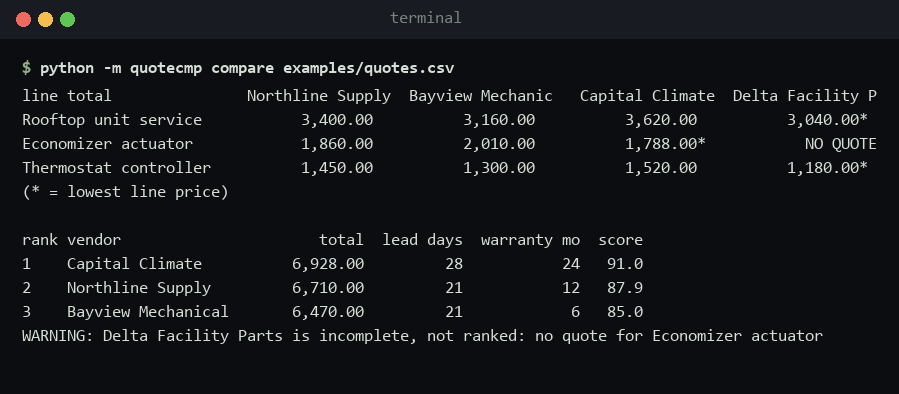

# quote-comparison-sheet

Three vendor quotes never arrive in the same shape. One leaves out a line, one quotes a different quantity, one is cheap but takes a month. This repo lines the quotes up item by item, flags what is missing or unfair, and ranks the complete bids with weights you choose for price, lead time and warranty.



## What it is for

Procurement coordinators and facility managers comparing quotes for repairs, equipment or services use this to see the lowest price per line, each vendor's total, and a documented score for the award memo. The weights are explicit, so the decision can be explained and repeated.

## Install

```
git clone https://github.com/yassine2med/quote-comparison-sheet
cd quote-comparison-sheet && pip install -r requirements.txt
```

## How to use

| I want to | Command |
|---|---|
| Compare quotes and rank complete bids | `PYTHONPATH=src python -m quotecmp compare examples/quotes.csv` |
| Weigh price more or less | `PYTHONPATH=src python -m quotecmp compare examples/quotes.csv --weights price=0.4,lead=0.4,warranty=0.2` |
| See a quantity mismatch warning | `PYTHONPATH=src python -m quotecmp compare examples/quotes_qty_mismatch.csv` |
| Show help | `PYTHONPATH=src python -m quotecmp --help` |

Exit codes: 0 when the comparison is clean, 1 when a bid is incomplete or quantities differ, 2 for a missing file, bad data or bad weights.

Example:

```
PYTHONPATH=src python -m quotecmp compare examples/quotes.csv
```

Output:

```
line total               Northline Supply  Bayview Mechanic   Capital Climate  Delta Facility P
Rooftop unit service           3,400.00          3,160.00          3,620.00          3,040.00* 
Economizer actuator            1,860.00          2,010.00          1,788.00*           NO QUOTE
Thermostat controller          1,450.00          1,300.00          1,520.00          1,180.00* 
(* = lowest line price)

rank vendor                      total  lead days  warranty mo  score
1    Capital Climate          6,928.00         28           24   91.0
2    Northline Supply         6,710.00         21           12   87.9
3    Bayview Mechanical       6,470.00         21            6   85.0
WARNING: Delta Facility Parts is incomplete, not ranked: no quote for Economizer actuator
```

Run the tests with `python -m pytest -q`.

## How it works

1. One CSV row per vendor and item: quantity, unit price, lead time in days, warranty in months.
2. The matrix shows each line total and marks the lowest. A vendor with no row for an item shows NO QUOTE.
3. A vendor's total is the sum of its lines, its lead time is the slowest line and its warranty is the shortest line.
4. Only complete bids are ranked. Score = 100 x (price weight x lowest total / total + lead weight x shortest lead / lead + warranty weight x warranty / longest warranty). Default weights are 0.6, 0.2 and 0.2.
5. If vendors quoted different quantities for the same item, a warning says the comparison is not like for like.

## Limits

- No tax, shipping, discounts or currency handling; put them into the unit price first.
- The score is a tool for discussion. It does not check vendor insurance, licences or references.
- CSV input only.

## License

MIT. Yassine Emhamed, 2026.
